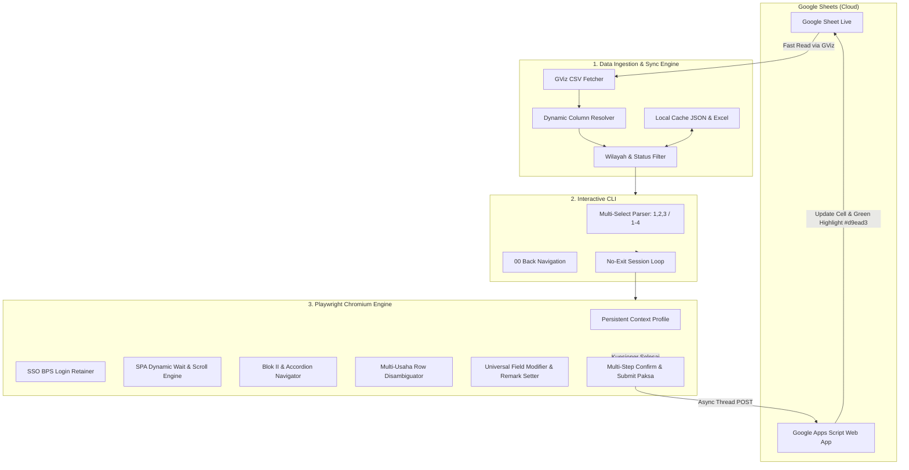

# 📘 FASIH-SM AUTOMATION PLAYBOOK & CORE ARCHITECTURE MANUAL
> **Panduan Arsitektur & Katalog Kode Inti (Core Patterns) untuk Membangun Bot Otomatisasi Fasih-SM BPS Berbasis Playwright & Google Sheets**

Dokumen ini mendokumentasikan secara lengkap arsitektur, alur kerja (*flow*), dan potongan kode inti (*battle-tested snippets*) dari bot Fasih-SM. Pola-pola di bawah ini dirancang agar **dapat langsung di-copy-paste dan diadaptasi** untuk membuat bot baru, seperti:
- Bot pengubah/pengisi isian (*field modifier / data entry bot*).
- Bot penambah catatan/anomali (*remark bot*).
- Bot validasi & verifikasi data (*consistency checking bot*).
- Bot otomasi submit/reject batch (*batch submission bot*).

---

## 📑 DAFTAR ISI
1. [Arsitektur Sistem & Alur Data](#1-arsitektur-sistem--alur-data)
2. [Pola 1: Fast Google Sheets Ingestion & Dynamic Header Resolver](#2-pola-1-fast-google-sheets-ingestion--dynamic-header-resolver)
3. [Pola 2: Interactive Terminal Menu & Multi-Select Lifecycle](#3-pola-2-interactive-terminal-menu--multi-select-lifecycle)
4. [Pola 3: Playwright Browser Lifecycle & SSO Anti-Bot Handling](#4-pola-3-playwright-browser-lifecycle--sso-anti-bot-handling)
5. [Pola 4: Navigasi Sidebar & Multi-Usaha Row Targeting](#5-pola-4-navigasi-sidebar--multi-usaha-row-targeting)
6. [Pola 5: Universal Form Filler & Field Modifier Engine](#6-pola-5-universal-form-filler--field-modifier-engine)
7. [Pola 6: Penanganan Popover / Catatan (Speech Bubble)](#7-pola-6-penanganan-popover--catatan-speech-bubble)
8. [Pola 7: Submission Cascade & Multi-Step Modal Confirmation](#8-pola-7-submission-cascade--multi-step-modal-confirmation)
9. [Pola 8: Real-Time Live Sync Google Apps Script (GAS)](#9-pola-8-real-time-live-sync-google-apps-script-gas)
10. [Template Boilerplate: Kerangka Dasar Bot Baru](#10-template-boilerplate-kerangka-dasar-bot-baru)

---

## 1. Arsitektur Sistem & Alur Data



---

## 2. Pola 1: Fast Google Sheets Ingestion & Dynamic Header Resolver

### Mengapa Pendekatan Ini Penting?
1. **Tanpa Google Cloud API Credential**: Menggunakan Google Visualization API (GViz) CSV export (`/gviz/tq?tqx=out:csv`). Kecepatan tinggi (hanya butuh < 1 detik untuk membaca puluhan ribu baris).
2. **Dynamic Header Resolver**: Kolom di spreadsheet sering kali digeser, disisipkan kolom baru, atau diubah namanya oleh pengguna. Menggunakan indeks kolom statis (seperti `row[5]`) akan langsung menyebabkan bug. Kita mencari header berdasarkan nama kolom secara case-insensitive.
3. **Multi-Usaha Keying**: 1 nomor assignment (`link_fasih`) dapat memiliki banyak usaha di Blok II. Kunci cache **WAJIB** menggabungkan `link` dan `nama_usaha`.

### Implementasi Python:
```python
import os
import re
import csv
import json
import time
import urllib.request
import urllib.parse

def clean_u(link):
    """Menghilangkan query string dan trailing slash dari link assignment Fasih-SM."""
    clean = str(link or "").split("?")[0].rstrip("/")
    if clean and not clean.endswith("/edit"):
        clean += "/edit"
    return clean

def make_cache_key(link, nama_usaha=""):
    """
    Membuat key cache kanonik unik untuk setiap usaha.
    PENTING: Selalu menggabungkan link dan nama_usaha agar assignment yang
    memiliki banyak usaha (multi-usaha) tidak saling menimpa atau terlewati!
    """
    clean_l = clean_u(link)
    clean_n = str(nama_usaha or "").strip()
    if clean_n:
        return f"{clean_l}::{clean_n}"
    return clean_l

def fetch_sheet_csv(url, backup_file=None):
    """Mengunduh CSV spreadsheet live dengan fallback ke backup lokal."""
    req_url = url + ("&_t=" if "?" in url else "?_t=") + str(int(time.time()))
    req = urllib.request.Request(
        req_url,
        headers={
            "User-Agent": "Mozilla/5.0 (Windows NT 10.0; Win64; x64)",
            "Cache-Control": "no-cache"
        }
    )
    for attempt in range(1, 4):
        try:
            with urllib.request.urlopen(req, timeout=30) as resp:
                content = resp.read().decode("utf-8")
                # Simpan cadangan lokal otomatis
                if backup_file:
                    os.makedirs(os.path.dirname(backup_file), exist_ok=True)
                    with open(backup_file, "w", encoding="utf-8") as bf:
                        bf.write(content)
                return content
        except Exception as e:
            if attempt < 3:
                time.sleep(2)
                continue
            if backup_file and os.path.exists(backup_file):
                print(f"[Warning] Gagal unduh live ({e}), menggunakan backup lokal: {backup_file}")
                with open(backup_file, "r", encoding="utf-8") as bf:
                    return bf.read()
            raise e

def parse_sheet_rows_dynamic(csv_text):
    """
    Memetakan header kolom secara cerdas tanpa hardcoded index.
    Aman terhadap perubahan urutan kolom di Google Sheet.
    """
    lines = [l for l in csv_text.splitlines() if l.strip()]
    if not lines:
        return []

    reader = csv.reader(lines)
    header = next(reader)
    h_clean = [h.strip().lower() for h in header]

    def find_col_idx(patterns):
        for p in patterns:
            for idx, col in enumerate(h_clean):
                if re.search(p, col, re.IGNORECASE):
                    return idx
        return -1

    # Deteksi posisi kolom target
    idx_link = find_col_idx([r"^link_fasih_sm$", r"^link_fasih$", r"^link$"])
    idx_nama = find_col_idx([r"^nama_usaha$", r"^nama usaha$", r"^nama$"])
    idx_desa = find_col_idx([r"^id_desa$", r"^id desa$", r"^desa$", r"^kelurahan$"])
    idx_petugas = find_col_idx([r"^petugas_cleaning$", r"^cleaning$", r"^petugas$"])
    idx_status = find_col_idx([r"^status$", r"^keterangan$"])

    data = []
    for row_num, row in enumerate(reader, start=2):
        if not row:
            continue
        link = row[idx_link].strip() if 0 <= idx_link < len(row) else ""
        if not link or "fasih" not in link.lower():
            continue

        item = {
            "row_num": row_num,
            "link": link,
            "nama_usaha": row[idx_nama].strip() if 0 <= idx_nama < len(row) else "",
            "id_desa": row[idx_desa].strip() if 0 <= idx_desa < len(row) else "",
            "petugas_cleaning": row[idx_petugas].strip() if 0 <= idx_petugas < len(row) else "0",
            "sheet_status": row[idx_status].strip() if 0 <= idx_status < len(row) else ""
        }
        data.append(item)
    return data
```

---

## 3. Pola 2: Interactive Terminal Menu & Multi-Select Lifecycle

### Fitur Utama:
1. **Multi-Select Parser**: Mendukung format `1,2,3`, `1 2 3`, `1-4`, `semua`, atau kombinasinya `1, 3-5, 8`.
2. **Navigasi `00` Kembali**: Di setiap layer pilihan (Kecamatan -> Desa -> Batch), user dapat mengetik `00` untuk mundur satu tingkat tanpa force-quit program.
3. **Continuous Looping (*No-Exit Session*)**: Setelah batch selesai diproses, bot TIDAK menutup browser atau keluar dari terminal. Bot melakukan resinkronisasi status dan menampilkan kembali menu pilihan.

### Implementasi Python:
```python
def parse_multi_choice(input_str, max_val):
    """
    Mengurai input pilihan multi menjadi list integer index 1-based yang unik dan terurut.
    Mendukung format:
      - '1,2,3' / '1 2 3'
      - Rentang: '1-4' (akan diekspansi menjadi 1, 2, 3, 4)
      - 'semua' / 'all'
      - '00' (Kembali)
    """
    raw = (input_str or "").strip()
    if not raw:
        return []
    if raw == "00":
        return "00"
    if raw.lower() in ["semua", "all", "*"]:
        return list(range(1, max_val + 1))

    parts = re.split(r'[,;\s]+', raw)
    selected = set()
    for p in parts:
        if not p:
            continue
        if "-" in p:
            sub = p.split("-")
            if len(sub) == 2 and sub[0].isdigit() and sub[1].isdigit():
                start, end = int(sub[0]), int(sub[1])
                if start <= end:
                    for x in range(start, end + 1):
                        if 1 <= x <= max_val:
                            selected.add(x)
                continue
        if p.isdigit():
            val = int(p)
            if 1 <= val <= max_val:
                selected.add(val)

    return sorted(list(selected))
```

### Pola Loop Sesi Tanpa Keluar (No-Exit Browser Loop):
```python
def main_lifecycle():
    browser_context = None
    browser_page = None

    try:
        while True:  # Outer loop: Sesi berjalan terus sampai user memilih keluar
            # 1. Unduh data & sync status sheet
            raw_data = load_and_sync_data()

            # 2. Menu Interaktif (Kecamatan / Desa) dengan opsi '00' & multi-select
            chosen_items = show_interactive_menus(raw_data)
            if chosen_items == "EXIT":
                print("Keluar dari aplikasi...")
                break
            if not chosen_items:
                continue

            # 3. Inisialisasi Browser Persistent Hanya Sekali!
            if browser_context is None:
                p = sync_playwright().start()
                browser_context = p.chromium.launch_persistent_context(
                    user_data_dir=os.path.join(os.getcwd(), "chrome_profile"),
                    headless=False,
                    no_viewport=True,
                    args=["--start-maximized", "--disable-blink-features=AutomationControlled"]
                )
                browser_page = browser_context.pages[0] if browser_context.pages else browser_context.new_page()
                browser_page.goto("https://fasih-sm.bps.go.id/")
                input("\nSilakan LOGIN ke Fasih-SM jika belum, lalu tekan ENTER untuk mulai...")

            # 4. Eksekusi Batch Target
            process_batch(browser_page, chosen_items)

            # 5. Tanya apakah ingin memproses wilayah/batch lain tanpa menutup browser
            print("\nProses batch selesai.")
            ulang = input("\nApakah ingin memproses batch/wilayah lain? (Y/T): ").strip().lower()
            if ulang not in ["y", "ya", "yes", ""]:
                break

    finally:
        if browser_context:
            browser_context.close()
```

---

## 4. Pola 3: Playwright Browser Lifecycle & SSO Anti-Bot Handling

### Konfigurasi Chromium Kebal Deteksi & Session SSO Persisten:
```python
from playwright.sync_api import sync_playwright

def init_persistent_browser(profile_dir):
    """
    Membuka browser Chromium dengan sesi login persisten.
    Flags anti-bot diset agar Cloudflare / WAF BPS tidak menganggap ini Selenium/Puppeteer.
    """
    os.makedirs(profile_dir, exist_ok=True)
    p = sync_playwright().start()
    context = p.chromium.launch_persistent_context(
        user_data_dir=profile_dir,
        headless=False,
        no_viewport=True,
        args=[
            "--start-maximized",
            "--disable-blink-features=AutomationControlled",
            "--no-sandbox",
            "--disable-infobars"
        ],
        ignore_default_args=["--enable-automation"]
    )
    return p, context
```

### Menunggu Kuesioner Fasih-SM Selesai Dimuat (SPA Reactive Waiter):
Fasih-SM adalah aplikasi SPA (Single Page Application) yang merender data secara lazy via AJAX. Membuka link `/edit` sering kali menampilkan blank page atau spinner selama 2-15 detik. Kode ini memastikan kuesioner benar-benar siap berinteraksi:

```python
def wait_for_kuesioner_ready(page, max_wait=35):
    """
    Memastikan halaman kuesioner Fasih-SM (/edit) telah selesai merender seluruh DOM.
    Menghindari error element not attached atau false loading.
    """
    start_time = time.time()
    reloaded = False

    while time.time() - start_time < max_wait:
        try:
            # 1. Periksa apakah form kuesioner utama sudah ter-mount di DOM
            is_ready = page.evaluate('''() => {
                const bodyText = (document.body.innerText || '').toLowerCase();
                
                // Deteksi jika terjadi error server 500 / blank
                if (bodyText.includes('500 internal server error') || bodyText.includes('an error occurred')) {
                    return 'server_error';
                }

                // Cek apakah spinner / progress loading global sedang aktif
                const spinners = Array.from(document.querySelectorAll('.animate-spin, [class*="spinner"], [class*="loader"], [role="progressbar"]'));
                const activeSpinners = spinners.filter(el => {
                    const s = window.getComputedStyle(el);
                    return s.display !== 'none' && s.visibility !== 'hidden' && el.offsetWidth > 0;
                });
                if (activeSpinners.length > 0) return 'loading';

                // Indikator kuesioner siap: sidebar berisi BLOK atau form rincian terlihat
                const hasBlokMenu = Array.from(document.querySelectorAll('aside, nav, ul, li, button, [role="tab"]')).some(el => {
                    const t = (el.innerText || el.textContent || '').trim().toUpperCase();
                    return t.includes('BLOK') || t.includes('SE2026') || t.includes('CATATAN');
                });

                return hasBlokMenu ? 'ready' : 'loading';
            }''')

            if is_ready == 'ready':
                time.sleep(0.5)
                return True

            if is_ready == 'server_error' and not reloaded:
                print("  -> Terdeteksi error server, melakukan page reload...")
                page.reload(wait_until="domcontentloaded", timeout=25000)
                reloaded = True
                time.sleep(2)
                continue

            time.sleep(0.8)
        except Exception:
            time.sleep(0.8)

    print(f"[Warning] Timeout {max_wait} detik menunggu kuesioner, melanjutkan dengan risiko...")
    return False
```

---

## 5. Pola 4: Navigasi Sidebar & Multi-Usaha Row Targeting

### 1. Membuka Menu / Blok di Sidebar (Dengan Auto-Accordion Expand):
Di Fasih-SM, menu seperti `SE2026 - L BLOK II` berada di dalam accordion yang bisa dalam keadaan tertutup (`collapsed`). Kita mengevaluasi DOM: jika sub-blok belum terlihat, klik parent accordion terlebih dahulu.

```python
def open_menu_blok(page, blok_keyword=r"BLOK\s*II\b"):
    """
    Membuka sub-menu blok tertentu di sidebar Fasih-SM.
    Otomatis mengekspansi accordion parent jika sub-menu belum terlihat.
    """
    res = page.evaluate('''(pattern) => {
        const reg = new RegExp(pattern, 'i');
        const regParent = /SE2026\s*[-–—]?\s*L\b/i;

        function getCleanText(el) {
            return (el.innerText || el.textContent || '').trim();
        }

        function clickEl(el) {
            el.scrollIntoView({ behavior: 'instant', block: 'center' });
            const rect = el.getBoundingClientRect();
            const opts = { bubbles: true, cancelable: true, view: window, clientX: rect.left + rect.width / 2, clientY: rect.top + rect.height / 2, pointerId: 1, pointerType: 'mouse', isPrimary: true };
            el.dispatchEvent(new PointerEvent('pointerdown', opts));
            el.dispatchEvent(new MouseEvent('mousedown', opts));
            el.dispatchEvent(new PointerEvent('pointerup', opts));
            el.dispatchEvent(new MouseEvent('mouseup', opts));
            el.click();
        }

        const elements = Array.from(document.querySelectorAll('aside, nav, [role="tablist"], ul, div[class*="sidebar"] *'));
        
        // 1. Cek apakah target sub-blok sudah ada di layar
        const matchedLeafs = elements.filter(el => {
            const t = getCleanText(el);
            return reg.test(t) && !Array.from(el.children).some(c => reg.test(getCleanText(c)));
        });

        if (matchedLeafs.length > 0) {
            const clickable = matchedLeafs[0].closest('a, button, [role="tab"], li, [tabindex]') || matchedLeafs[0];
            clickEl(clickable);
            return { success: true, target: getCleanText(clickable) };
        }

        // 2. Jika belum tampak, cari dan klik accordion parent 'SE2026 - L'
        const parentLeafs = elements.filter(el => {
            const t = getCleanText(el);
            return regParent.test(t) && !Array.from(el.children).some(c => regParent.test(getCleanText(c)));
        });

        if (parentLeafs.length > 0) {
            const parentBtn = parentLeafs[0].closest('a, button, [role="tab"], li') || parentLeafs[0];
            clickEl(parentBtn);
            return { success: false, expanded: true };
        }

        return { success: false };
    }''', blok_keyword)
    return res
```

### 2. Disambiguasi Multi-Usaha (Memilih Baris Usaha Tertentu):
Jika 1 nomor assignment memiliki banyak usaha di Blok II, bot harus mengklik tombol **"Lihat Rincian"** pada usaha yang tepat berdasarkan `nama_usaha`, BUKAN selalu mengklik baris pertama!

```python
def select_usaha_row(page, target_nama_usaha):
    """
    Mencari kartu usaha / baris tabel yang cocok secara presisi dengan nama usaha target
    lalu mengklik tombol 'Lihat Rincian' pada baris tersebut.
    """
    clean_target = (target_nama_usaha or "").strip()

    res = page.evaluate('''(targetName) => {
        function cleanStr(s) {
            return (s || '').toLowerCase().replace(/[^a-z0-9]/g, '');
        }

        function clickEl(el) {
            el.scrollIntoView({ behavior: 'instant', block: 'center' });
            el.click();
        }

        const uTarget = cleanStr(targetName);
        
        // Cari semua kontainer baris usaha (card atau tr)
        const rows = Array.from(document.querySelectorAll('tr[role="row"], tr, div[class*="card"], div[class*="border"][class*="rounded"]'));
        
        // Filter kontainer yang memiliki tombol 'Lihat Rincian'
        const candidateRows = rows.filter(r => {
            const btn = r.querySelector('button, a');
            const txt = (r.innerText || '').toLowerCase();
            return txt.includes('lihat rincian') || txt.includes('rincian');
        });

        let matchedRow = null;
        for (const row of candidateRows) {
            const rowText = cleanStr(row.innerText || '');
            if (uTarget && rowText.includes(uTarget)) {
                matchedRow = row;
                break;
            }
        }

        // Fallback: jika hanya ada 1 baris usaha
        if (!matchedRow && candidateRows.length === 1) {
            matchedRow = candidateRows[0];
        }

        if (matchedRow) {
            const btn = Array.from(matchedRow.querySelectorAll('button, a')).find(b => {
                const t = (b.innerText || b.textContent || '').toLowerCase();
                return t.includes('rincian') || t.includes('lihat');
            });
            if (btn) {
                clickEl(btn);
                return { success: true };
            }
        }
        return { success: false };
    }''', clean_target)

    return res and res.get("success")
```

---

## 6. Pola 5: Universal Form Filler & Field Modifier Engine

Ini adalah **inti paling krusial untuk membuat bot pengubah/pengisi field**.

### ⚠️ Masalah Umum pada Modern SPA (React / Tailwind):
Jika Anda hanya menjalankan `input.value = "100"`, React State **TIDAK AKAN BERUBAH** karena React membungkus property getter/setter bawaan HTML! Saat form dikirim, nilainya akan kembali ke semula atau kosong.

### Solusi Ampuh (Prototype Descriptor Hook):
Kita menggunakan setter asli dari `HTMLInputElement.prototype` atau `HTMLTextAreaElement.prototype` dan memicu event `input` dan `change` secara sintetis:

```javascript
const proto = targetInput.tagName === 'TEXTAREA' ? window.HTMLTextAreaElement.prototype : window.HTMLInputElement.prototype;
const desc = Object.getOwnPropertyDescriptor(proto, 'value');
if (desc && desc.set) {
    desc.set.call(targetInput, newValue);
} else {
    targetInput.value = newValue;
}
targetInput.dispatchEvent(new Event('input', { bubbles: true }));
targetInput.dispatchEvent(new Event('change', { bubbles: true }));
```

### Python Function Universal untuk Mengisi Isian Field Berdasarkan Label/Nomor:
```python
def set_field_value_by_label(page, label_pattern, new_value):
    """
    Mencari elemen input/textarea berdasarkan label teks terdekat atau nomor pertanyaan,
    lalu mengubah nilainya secara aman dengan memicu React reactive state update.
    
    Contoh:
      set_field_value_by_label(page, r"jumlah pekerja", "5")
      set_field_value_by_label(page, r"27\s*\.?\s*a", "15000000")
    """
    res = page.evaluate('''([pattern, val]) => {
        const reg = new RegExp(pattern, 'i');
        
        function getCleanText(el) {
            return (el.innerText || el.textContent || '').trim();
        }

        // 1. Temukan teks label yang cocok
        const allElements = Array.from(document.querySelectorAll('*'));
        const labelNodes = allElements.filter(el => {
            const t = getCleanText(el);
            return reg.test(t) && !Array.from(el.children).some(c => reg.test(getCleanText(c)));
        });

        if (labelNodes.length === 0) {
            return { success: false, reason: 'label_not_found' };
        }

        const label = labelNodes[0];
        
        // 2. Cari input di baris kontainer terdekat
        const row = label.closest('tr, [role="row"], div[class*="grid"], div[class*="flex"], div[class*="rounded"]') || 
                    label.parentElement.parentElement;

        let input = row.querySelector('input:not([type="hidden"]), textarea');
        
        if (!input) {
            return { success: false, reason: 'input_not_in_container' };
        }

        input.scrollIntoView({ behavior: 'instant', block: 'center' });
        input.focus();

        // 3. React State Safe Setter
        const proto = input.tagName === 'TEXTAREA' ? window.HTMLTextAreaElement.prototype : window.HTMLInputElement.prototype;
        const desc = Object.getOwnPropertyDescriptor(proto, 'value');
        if (desc && desc.set) {
            desc.set.call(input, String(val));
        } else {
            input.value = String(val);
        }

        input.dispatchEvent(new Event('input', { bubbles: true }));
        input.dispatchEvent(new Event('change', { bubbles: true }));
        input.dispatchEvent(new Event('blur', { bubbles: true }));

        return { success: true, oldValue: input.value };
    }''', [label_pattern, str(new_value)])

    return res
```

### Mengubah Radio Button / Pilihan Opsi:
```python
def select_radio_option_by_label(page, question_pattern, option_text_pattern):
    """
    Memilih opsi radio button pada pertanyaan tertentu.
    Contoh:
      select_radio_option_by_label(page, r"status kepemilikan", r"milik sendiri")
    """
    res = page.evaluate('''([qPattern, optPattern]) => {
        const regQ = new RegExp(qPattern, 'i');
        const regOpt = new RegExp(optPattern, 'i');

        function getCleanText(el) {
            return (el.innerText || el.textContent || '').trim();
        }

        // Temukan kontainer pertanyaan
        const all = Array.from(document.querySelectorAll('*'));
        const qLeaf = all.find(el => regQ.test(getCleanText(el)) && !Array.from(el.children).some(c => regQ.test(getCleanText(c))));
        if (!qLeaf) return { success: false, reason: 'question_not_found' };

        const container = qLeaf.closest('div[class*="space-y"], div[class*="field"], tr, fieldset') || qLeaf.parentElement.parentElement;
        
        // Cari opsi radio
        const radios = Array.from(container.querySelectorAll('label, div[role="radio"], input[type="radio"]'));
        const targetRadio = radios.find(r => regOpt.test(getCleanText(r)));

        if (targetRadio) {
            targetRadio.scrollIntoView({ behavior: 'instant', block: 'center' });
            targetRadio.click();
            return { success: true };
        }

        return { success: false, reason: 'option_not_found' };
    }''', [question_pattern, option_text_pattern])
    return res
```

---

## 7. Pola 6: Penanganan Popover / Catatan (Speech Bubble)

### Pelajaran Penting dari Kasus Lapangan:
1. **Dua Tombol Catatan di HTML**:
   Fasih-SM merender dua tombol catatan untuk tata letak responsif:
   - Tombol mobile (tersembunyi di desktop: `tw:@lg/form:hidden`).
   - Tombol desktop (tampil di desktop: `tw:@lg/form:flex! tw:hidden`).
   Jika bot mengklik tombol yang tersembunyi (`offsetWidth == 0`), popover tidak akan pernah terbuka! **Selalu cek `isVisible()`**.
2. **Pertanyaan 27.a vs 31.a**:
   Usaha yang baru mulai tahun berjalan (2026) tidak memiliki pertanyaan 27.a, melainkan dialihkan ke pertanyaan 31.a. Bot harus memiliki fallback fleksibel mencari 27.a atau 31.a.

### Implementasi Lengkap Klik Catatan & Isi Popover:
```python
def add_remark_to_question(page, question_keyword, remark_text="#0"):
    """
    Mencari tombol Catatan pada baris pertanyaan, membukanya,
    mengisikan catatan ke textarea popover Radix UI, dan mengklik Simpan.
    """
    # 1. Klik Tombol Catatan pada baris pertanyaan
    res_click = page.evaluate('''(qPattern) => {
        const reg = new RegExp(qPattern, 'i');
        
        function getCleanText(el) {
            return (el.innerText || el.textContent || '').trim();
        }

        function isVisible(el) {
            if (!el) return false;
            const s = window.getComputedStyle(el);
            return s.display !== 'none' && s.visibility !== 'hidden' && s.opacity !== '0' && el.offsetWidth > 0;
        }

        // Cari label pertanyaan
        const all = Array.from(document.querySelectorAll('*'));
        const label = all.find(el => reg.test(getCleanText(el)) && !Array.from(el.children).some(c => reg.test(getCleanText(c))));
        if (!label) return { success: false, reason: 'label_not_found' };

        // Cari baris pembungkus pertanyaan
        const row = label.closest('div[class*="rounded"], div[class*="py-2"], tr, [role="row"]') || label.parentElement.parentElement;
        
        // Cari tombol catatan di baris tersebut
        const catBtns = Array.from(row.querySelectorAll('button[title*="Catatan" i], button[aria-label*="Catatan" i], [role="button"][title*="Catatan" i]'));
        const targetBtn = catBtns.find(isVisible) || catBtns[catBtns.length - 1];

        if (targetBtn) {
            targetBtn.scrollIntoView({ behavior: 'instant', block: 'center' });
            targetBtn.click();
            return { success: true };
        }
        return { success: false, reason: 'catatan_button_not_found' };
    }''', question_keyword)

    if not res_click or not res_click.get("success"):
        return False, "Gagal mengklik tombol catatan"

    time.sleep(0.4)

    # 2. Isi Textarea di dalam Popover Aktif
    res_fill = page.evaluate('''(txt) => {
        // Cari wrapper popover aktif
        const dialogs = Array.from(document.querySelectorAll('div[role="dialog"], [data-radix-popper-content-wrapper], div[class*="popover"]'));
        const activeDialog = dialogs.find(d => {
            const s = window.getComputedStyle(d);
            return s.display !== 'none' && s.visibility !== 'hidden' && d.offsetWidth > 0;
        });

        const scope = activeDialog || document.body;
        const textarea = scope.querySelector('textarea, input[type="text"]');
        if (!textarea) return { success: false, reason: 'textarea_not_found' };

        textarea.focus();
        
        // React Safe Setter
        const proto = window.HTMLTextAreaElement.prototype;
        const desc = Object.getOwnPropertyDescriptor(proto, 'value');
        if (desc && desc.set) {
            desc.set.call(textarea, txt);
        } else {
            textarea.value = txt;
        }

        textarea.dispatchEvent(new Event('input', { bubbles: true }));
        textarea.dispatchEvent(new Event('change', { bubbles: true }));

        // Klik tombol Simpan Catatan di dalam popover
        const saveBtn = Array.from(scope.querySelectorAll('button')).find(b => {
            const t = (b.innerText || b.textContent || '').trim().toLowerCase();
            return t === 'simpan' || t.includes('simpan');
        });

        if (saveBtn) {
            saveBtn.click();
            return { success: true, saved: true };
        }

        return { success: true, saved: false };
    }''', remark_text)

    time.sleep(0.4)
    return True, "Catatan berhasil ditambahkan dan disimpan"
```

---

## 8. Pola 7: Submission Cascade & Multi-Step Modal Confirmation

Proses submit di Fasih-SM memiliki alur berlapis:
1. Menuju menu **Catatan** di sidebar.
2. Memastikan switch **"Tampilkan Anomali Usaha dan Keluarga"** bernilai `TRUE` (aktif).
3. Mengklik tombol **"Kirim"**.
4. Mengonfirmasi modal bertingkat (biasanya butuh klik `Ya, Lanjutkan` atau `Konfirmasi` 2 kali).
5. Jika ada split button (titik tiga) / peringatan anomali, lakukan override dengan **"Submit Paksa"**.
6. Menunggu respons server sampai URL beralih (*redirect*) atau toast sukses terkonfirmasi.

### 1. Memastikan Switch Anomali Aktif:
```python
def ensure_tampilkan_anomali_checked(page):
    """Memastikan toggle 'Tampilkan Anomali Usaha dan Keluarga' dalam posisi ON (checked)."""
    res = page.evaluate('''() => {
        const all = Array.from(document.querySelectorAll('*'));
        const label = all.find(el => (el.innerText || '').toLowerCase().includes('tampilkan anomali'));
        if (!label) return false;

        const row = label.closest('div[class*="flex"]') || label.parentElement;
        const input = row.querySelector('input[role="switch"], input[type="checkbox"]');
        const control = row.querySelector('div[id$="-control"], div[role="group"]');

        const isChecked = (input && input.getAttribute('aria-checked') === 'true') || 
                          (control && control.hasAttribute('data-checked'));

        if (!isChecked) {
            const target = control || input;
            target.click();
            return true;
        }
        return true;
    }''')
    return res
```

### 2. Multi-Step Confirmation & Submit Paksa:
```python
def click_kirim_and_confirm(page):
    """Menyelesaikan seluruh alur submit dan konfirmasi bertingkat."""
    # 1. Klik tombol 'Kirim' / 'Submit'
    page.evaluate('''() => {
        const btns = Array.from(document.querySelectorAll('button'));
        const kirimBtn = btns.find(b => {
            const t = (b.innerText || '').trim().toLowerCase();
            return t === 'kirim' || t === 'submit';
        });
        if (kirimBtn) kirimBtn.click();
    }''')
    time.sleep(0.4)

    # 2. Konfirmasi bertingkat 1 & 2 (Modal Popups)
    for _ in range(3):
        handled = page.evaluate('''() => {
            const btns = Array.from(document.querySelectorAll('button')).filter(b => b.offsetWidth > 0);
            const conf = btns.find(b => {
                const t = (b.innerText || '').trim().toLowerCase();
                return t === 'ya' || t === 'konfirmasi' || t.includes('ya, kirim') || t.includes('ya, submit');
            });
            if (conf) {
                conf.click();
                return true;
            }
            return false;
        }''')
        if handled:
            time.sleep(0.5)
        else:
            break

    # 3. Handle 'Submit Paksa' jika form terkunci anomali
    page.evaluate('''() => {
        // Cek split button dropdown
        const splitBtn = Array.from(document.querySelectorAll('button')).find(b => (b.className || '').includes('border-l'));
        if (splitBtn) splitBtn.click();
        
        // Klik 'Submit Paksa'
        const paksa = Array.from(document.querySelectorAll('button, [role="menuitem"]')).find(el => (el.innerText || '').trim().toLowerCase() === 'submit paksa');
        if (paksa) paksa.click();
    }''')
    time.sleep(0.3)
```

### 3. Verifikasi Pengiriman Selesai (*Wait For Submit Finish*):
```python
def wait_for_submit_finish(page, max_wait=45):
    """
    Menunggu sampai pengiriman tuntas.
    JANGAN PERNAH lanjut ke link berikutnya jika server belum merespons!
    """
    start_time = time.time()
    time.sleep(0.5)

    while time.time() - start_time < max_wait:
        # A. Deteksi URL dialihkan keluar dari /edit
        if "/edit" not in (page.url or "").lower():
            return True, "Sukses dikirim (redirect)"

        # B. Deteksi feedback teks sukses / error toast
        status = page.evaluate('''() => {
            const text = (document.body.innerText || '').toLowerCase();
            if (text.includes('failed to fetch')) return 'error';
            if (text.includes('berhasil dikirim') || text.includes('berhasil disubmit')) return 'success';
            
            // Cek apakah spinner kirim masih berputar
            const spinners = Array.from(document.querySelectorAll('.animate-spin, [class*="spinner"]')).filter(el => el.offsetWidth > 0);
            return spinners.length > 0 ? 'loading' : 'idle';
        }''')

        if status == 'success':
            return True, "Sukses terkonfirmasi"
        if status == 'error':
            return False, "Toast 'Failed to fetch' muncul dari server"

        time.sleep(0.5)

    return True, "Submit selesai (timeout buffer)"
```

---

## 9. Pola 8: Real-Time Live Sync Google Apps Script (GAS)

### Arsitektur Sinkronisasi:
1. **Python Client (Non-Blocking)**: Mengirim request HTTP POST di background thread sehingga bot tidak berhenti berputar saat menunggu Google Sheet selesai mewarnai baris.
2. **Google Apps Script Backend**:
   - Membaca parameter `link`, `nama_usaha`, dan `status`.
   - Menggunakan `ScriptLock` untuk mencegah race-condition saat ada banyak operator.
   - Mengubah cell status menjadi **"SELESAI (BOT)"**.
   - Mewarnai baris dengan warna hijau lembut (`#d9ead3`).

### Kode Google Apps Script (`Code.gs`):
```javascript
function doPost(e) {
  var lock = LockService.getScriptLock();
  try {
    lock.waitLock(15000); // Tunggu lock maksimal 15 detik
    
    var params = JSON.parse(e.postData.contents);
    var ss = SpreadsheetApp.getActiveSpreadsheet();
    var sheet = ss.getSheetByName(params.sheet_name) || ss.getSheets()[0];
    
    var targetRow = parseInt(params.row_num);
    if (targetRow > 1) {
      // 1. Update teks status
      sheet.getRange(targetRow, params.status_col_idx || 15).setValue("SELESAI (BOT)");
      
      // 2. Warnai baris hijau muda
      sheet.getRange(targetRow, 1, 1, sheet.getLastColumn()).setBackground("#d9ead3");
      
      return ContentService.createTextOutput(JSON.stringify({ status: "success", row: targetRow }))
        .setMimeType(ContentService.MimeType.JSON);
    }
  } catch (err) {
    return ContentService.createTextOutput(JSON.stringify({ status: "error", message: err.toString() }))
      .setMimeType(ContentService.MimeType.JSON);
  } finally {
    lock.releaseLock();
  }
}
```

### Python Asynchronous Background Push:
```python
import threading
import urllib.request
import json

def push_to_sheets_async(gas_webapp_url, payload):
    """Mengirim update status ke Google Sheet di latar belakang (non-blocking)."""
    def _worker():
        try:
            req = urllib.request.Request(
                gas_webapp_url,
                data=json.dumps(payload).encode("utf-8"),
                headers={"Content-Type": "application/json"}
            )
            urllib.request.urlopen(req, timeout=10)
        except Exception as e:
            print(f"[Warning] Gagal push background ke sheets: {e}")

    threading.Thread(target=_worker, daemon=True).start()
```

---

## 10. Template Boilerplate: Kerangka Dasar Bot Baru

Gunakan kerangka dasar di bawah ini untuk memulai bot pengubah field / verifikasi baru Anda:

```python
#!/usr/bin/env python3
"""
TEMPLATE BOT BARU FASIH-SM (FIELD MODIFIER & SPREADSHEET SYNC)
"""

import os
import sys
import time
import json
import openpyxl
from playwright.sync_api import sync_playwright

# 1. Konfigurasi
SHEET_CSV_URL = "https://docs.google.com/spreadsheets/d/YOUR_SPREADSHEET_ID/export?format=csv&gid=0"
CHROME_PROFILE = os.path.join(os.path.dirname(__file__), "chrome_profile")

def process_single_assignment(page, item):
    """Alur eksekusi per baris kuesioner Fasih-SM."""
    link = item["link"]
    nama_usaha = item["nama_usaha"]

    print(f"\n-> Membuka link: {link}")
    page.goto(link, wait_until="domcontentloaded", timeout=45000)

    # 1. Tunggu kuesioner siap
    if not wait_for_kuesioner_ready(page):
        return False, "Timeout loading kuesioner"

    # 2. Buka Blok II di sidebar
    open_menu_blok(page, r"BLOK\s*II\b")
    time.sleep(0.5)

    # 3. Pilih baris usaha yang cocok
    select_usaha_row(page, nama_usaha)
    time.sleep(0.5)

    # 4. Modifikasi Field / Isi Nilai Form
    # CONTOH: Mengubah pertanyaan tertentu
    set_field_value_by_label(page, r"nilai pendapatan", "50000000")
    
    # CONTOH: Menambahkan remark jika ada
    add_remark_to_question(page, r"nilai pendapatan", remark_text="#0")

    # 5. Simpan Rincian Usaha
    page.evaluate('''() => {
        const btn = Array.from(document.querySelectorAll('button')).find(b => (b.innerText || '').toLowerCase() === 'simpan');
        if (btn) btn.click();
    }''')
    time.sleep(0.5)

    # 6. Menuju Menu Catatan & Submit
    page.get_by_role("tab", name="Catatan").click()
    ensure_tampilkan_anomali_checked(page)
    click_kirim_and_confirm(page)

    # 7. Verifikasi feedback server
    ok, msg = wait_for_submit_finish(page)
    return ok, msg

# Jalankan lifecycle interaktif di sini...
```

---

*Dokumentasi ini disusun sebagai standar arsitektur otomasi Fasih-SM BPS. Simpan dan gunakan blueprint ini setiap kali membangun varian bot Fasih-SM baru.*
